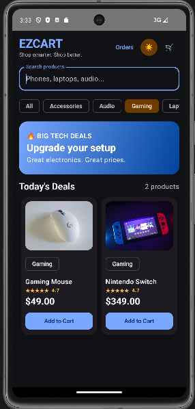
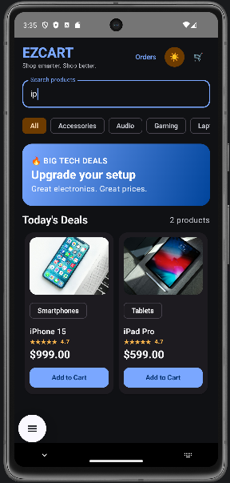

# EZCART – Android E-Commerce Application

EZCART is a native Android shopping application built with **Kotlin, Jetpack Compose, MVVM, and Room**. It demonstrates modern Android development practices through reactive UI development, asynchronous programming, layered architecture, and persistent local data storage.

The application implements end-to-end shopping workflows, including product discovery, search and filtering, cart management, checkout, receipt generation, and persistent order history.

## Demo
[▶ Watch EZCART Demo](photos-videos/Ezcart%20Demo.mp4)

## Screenshots

### Product Catalog


### Categories


### Search and Filtering


### Shopping Cart


### Checkout and Receipt


### Order History


## Features

- **Product Catalog:** Browse products with images, categories, and prices.
- **Search and Filtering:** Search and Filtering: Search products by name and filter by category.
- **Shopping Cart:** Add products, update quantities, remove items, and view dynamically updated totals.
- **Checkout:** Review order details and totals through a simulated checkout flow.
- **Order History:** Persist orders and associated order items using Room and view previous purchases.
- **Receipts:** Display order details and purchase summaries after checkout.
- **Offline Persistence:** Store product, cart, and order data locally using Room and SQLite.
- **Reactive UI:** Use Kotlin Coroutines and Flow for asynchronous operations and observable application state.
- **Modern UI:** Build responsive shopping screens with Jetpack Compose and Material 3, including light and dark themes.

## Technology Stack

| Category | Technologies |
|---|---|
| Language | Kotlin |
| UI | Jetpack Compose, Material 3 |
| Architecture | MVVM, Repository Pattern |
| Database | Room, SQLite |
| Asynchronous Programming | Kotlin Coroutines, Flow |
| Image Loading | Coil |
| Development Tools | Android Studio, Gradle |

## Architecture

The application follows a layered MVVM architecture that separates UI rendering, business logic, and data persistence:

- **UI Layer:** Implements Compose screens for product browsing, cart management, checkout, receipts, and order history.
- **ViewModel Layer:** Manages screen state and coordinates user actions using observable UI state and asynchronous operations.
- **Repository Layer:** Centralizes access to product, cart, and order data while abstracting database operations from ViewModels.
- **Database Layer:** Uses Room entities and DAOs to persist products, cart items, orders, and order items in a local SQLite database.

This architecture promotes separation of concerns, maintainability, and extensibility.

## Getting Started

### Prerequisites

- Android Studio
- Android SDK
- JDK compatible with the project configuration

### Installation

1. Clone this repository:

   ```bash
   git clone https://github.com/SunnyN01/EZCART-Android-Ecommerce.git
2. Open the project in Android Studio.
3. Allow Gradle to sync and resolve dependencies.
4. Run the application on an Android emulator or compatible Android device.

## Checkout and Payments

Checkout currently uses a **simulated payment flow**. A production payment gateway has not been integrated.

## Future Improvements

- Integrate a payment provider.
- Add automated unit and UI tests.
- Improve product data sourcing and catalog management.
- Explore remote REST API integration while retaining local persistence.
- Expand application reliability and performance testing.

## Author

Developed as a personal Android application project demonstrating native Android development, modern application architecture, reactive programming, and local database persistence.
